# Cline 运行时图示、社区问题与 Issue 研究资料包

> 供工程师听众的技术分享备用材料，不是幻灯片，也不是产品评价或故障清单。  
> Xin · 配套现有 40 分钟讲稿（`/workspace/cline-tech-sharing.md`）  
> 收集与核对：2026-11-18（Asia/Shanghai）  
> Cline 静态事实钉在公开仓库提交 [`4cdfb19a5e897b9e75827cbb4f280f322e27e44a`](https://github.com/cline/cline/commit/4cdfb19a5e897b9e75827cbb4f280f322e27e44a)（提交时间 2026-11-17 17:13:09 Asia/Shanghai；原标注 `2026-11-17 10:13:09 +0100`）

本包只做只读收集与本地重绘。没有向 GitHub 发帖、评论或改仓库；没有运行 Cline 仓库代码或安装其依赖。文中数字、引言、作者与日期均来自本轮打开的页面或 API；若某条只来自搜索摘要或未能打开原页，会单独标明。

**时代分界（贯穿全文）：**

| 标签 | 含义 | 分享时如何用 |
|---|---|---|
| 新 AgentRuntime 分层 | `shared → llms → agents → core → apps`，循环在 `AgentRuntime` / `ClineCore` | 作为**当前**主图 |
| 旧 Task 循环 | `src/core/task/index.ts`、`Controller`、`WebviewProvider`、`initiateTaskLoop` / `recursivelyMakeClineRequests` | 只作为**历史地图**，不要讲成当前实现 |
| 混合 | 同时画旧 Task 路径并提到 SDK / AgentRuntime | 需要口头标明哪一层仍可能存在、哪一层已是主循环 |
| 自动生成概览 | 由文件树/README 采样生成，未逐条对源码 | 只作导航，不对听众断言接线细节 |

---

## 1. 如何把本包插进现有 40 分钟分享

现有讲稿的时间表是：0–4 分钟提出问题；**4–9 分钟讲当前架构与历史地图**；9–21 分钟走同一道 bug 的执行旅程；21–27 分钟讲状态、恢复与委派；27–35 分钟比较 Claude Code；35–40 分钟收束原则。本包不要另开一条主线，只给第 2 章和第 3 / 8 章各补一块可投影的证据。

### 1.1 建议插入的 1–2 张图

**主图（第 2 章，约 4–9 分钟）：** [官方分层模型](#fig-official-layered)，来自钉选提交的 `sdk/ARCHITECTURE.md`。它直接对应讲稿里的“不要拿旧架构图解释新快照”。如果还想用一句话说明宿主与编排边界，可换成或并排 [官方文档 Package Stack 重绘图](#fig-official-package-stack)（据 docs 的 ASCII 重绘，不是仓库里的 mermaid 原件）。

**第二张（视当天重点二选一，不要两张都展开）：**

- 若强调审批与“拒绝必须落到执行器”：用 David P. S. Marques 的 [Approval 序列图](#fig-dpsm-approval)（v4.1.22 / AgentRuntime 时代，第三方但钉了提交）。官方权限文档本身几乎没有图，不要拿旧 Task 序列图来讲当前 `requestToolApproval`。
- 若强调上下文与恢复：用 [PR #10651 的 canonical history / sidecar 重绘图](#fig-official-compaction)，并口头对照官方 Auto Compact 文档——文档写的是“接近窗口就摘要并替换对话历史”，PR 文本则把**规范成绩单**和**发给模型的工作上下文**分开。这是设计演变，不要把两者讲成同一张图。

**不要在第 2 章投影的图：** `.clinerules/cline-overview.md` 的 Task / Webview 总图、AIGC Camp 以 `recursivelyMakeClineRequests` 为中心的流程图、Cline 源码解析电子书的章节结构。它们可以放进“历史对照”或 Q&A，但若当作当前架构，会和讲稿第 2.1 节直接冲突。

### 1.2 建议现场点名的 3 个 Issue

挑**能服务设计原则**的三条，而不是评论数最高的三条。评论很多的 Issue 往往更杂（例如终端集成 #4356），未必适合 1 分钟讲清。

1. **[#15661](https://github.com/cline/cline/issues/15661)（已关闭 completed）——压缩触发 ≠ 服务器硬限制。** VS Code 4.1.26 上，本地上下文窗口报 `request exceeds the context window`，提问者认为 Auto Compact 没有在撞墙前启动。一条非维护者回复指出：预请求 token 估计与本地服务器硬 `n_ctx` 检查存在时机错位，且大工具输出可能让请求在推理前就被拒绝，从而走不到回合结束后的自动压缩。Issue 由提问者 @pboeckmannOS 于 2026-11-13 22:02:09 Asia/Shanghai 以 completed 关闭；这记录的是“说明被接受 / 讨论结束”，**本轮没有核到一次对应的产品修复提交**。用来收束讲稿里“compaction trigger vs server hard limit”。
2. **[#15738](https://github.com/cline/cline/issues/15738)（仍开放）——Plan 模式拿掉了本机编辑工具，并不等于关掉了所有写入面。** JetBrains / WebStorm，Cline 4.1.26：Edit/Execute 权限关闭、Use MCP servers 开启时，模型仍通过 MCP 的 `apply_patch` 改文件。贡献者 @mkondratek（`CONTRIBUTOR`）在 2026-11-16 20:59:01 Asia/Shanghai 确认这一判断，并写明拟议修复是：Plan 模式只暴露声明为只读的 MCP 工具，未声明的一律询问；同时指向本包钉选提交所含的 [#15381](https://github.com/cline/cline/pull/15381) 为准备工作，且“does not change behavior yet”。用来讲“策略信任的是工具分类，分类一旦泄漏，模式开关就会失效”。若还要补一条“拒绝未进入执行器”的历史报告，用 [#10783](https://github.com/cline/cline/issues/10783)（关闭原因 `not_planned`，由 `linear-code[bot]` 关闭，**没有公开的维护者结案说明**），不要把它讲成官方已确认的根因。
3. **[#10549](https://github.com/cline/cline/issues/10549)（仍开放）——timeout ≠ 命令失败，更不等于 cancel。** CLI 上 `run_commands` 在约 30 秒后给出误导性失败，智能体把“等待结束”当成“命令失败”并浪费后续回合。贡献者 @minh2416294 在 2026-08-03 15:53:44 Asia/Shanghai 表示误导性文案有具体代码位置并准备了一份小修复；**本轮未把它核实为已合并**。若要换一个更贴近 CLI 上下文满载的例子，用仍开放且被标 `stale` 的 [#9323](https://github.com/cline/cline/issues/9323)：窗口满了出现 Retry，但 CLI 只能 Exit。用来呼应讲稿“停止 ≠ 成功，timeout ≠ cancellation”。

现场各用两三句话即可：现象、它暴露的不变式、当前状态（开放 / 关闭及其含义）。不要宣读评论区。

---

## 2. 图集与评注

下列每张图都给出：标题、来源 URL、作者（已核实才写）、日期或“未标注”、描绘内容、架构时代、分享用途、限制、官方或第三方、本地副本路径。能合法下载或从公开 mermaid 重绘的，已放在 `/workspace/cline-sharing-assets/`，并在 HTML 中内联。重绘不是新发明的架构，只是把官方或原文中的 mermaid / ASCII 画出来；若某页是 JS 重页面且本轮无法抓到图，会保留经 HTTP 检查的活链接。

### 2.1 当前：官方 AgentRuntime 分层（优先投影）

#### 官方分层模型（仓库 mermaid） {#fig-official-layered}

- **来源：** [`sdk/ARCHITECTURE.md`](https://github.com/cline/cline/blob/4cdfb19a5e897b9e75827cbb4f280f322e27e44a/sdk/ARCHITECTURE.md)（`main` 上的 blob 页 2026-11-18 检查为 HTTP 200；内容按钉选提交读取）
- **作者 / 日期：** Cline 仓库该文件；随提交 `4cdfb19a…`（2026-11-17 17:13:09 Asia/Shanghai）
- **描绘：** `@cline/shared`、`@cline/llms`、`@cline/agents`、`@cline/core`、Host Apps 的单向依赖。
- **时代：** 新 AgentRuntime 分层
- **属性：** 官方
- **用途：** 第 2 章主图。用它代替任何 Task/Webview 总图。
- **限制：** 只画包边界，不画审批、压缩、Hub 时序。
- **本地副本：** `cline-sharing-assets/official/layered-sdk.svg`

#### 官方依赖方向（AGENTS.md mermaid） {#fig-official-deps}

- **来源：** [`sdk/AGENTS.md`](https://github.com/cline/cline/blob/4cdfb19a5e897b9e75827cbb4f280f322e27e44a/sdk/AGENTS.md)
- **作者 / 日期：** 同上钉选提交
- **描绘：** 与上一张同类，箭头方向写成 `shared → llms/agents/core → apps`。两张应一起看，不要讲成两套架构。
- **时代：** 新 AgentRuntime 分层 · 官方
- **用途：** 备用；与主图择一即可。
- **限制：** 更简，信息量低于 ARCHITECTURE.md 那张。
- **本地副本：** `cline-sharing-assets/official/agents-deps.svg`


#### 官方文档 Package Stack（据 ASCII 重绘） {#fig-official-package-stack}

- **来源：** [docs.cline.bot/sdk/architecture/overview](https://docs.cline.bot/sdk/architecture/overview)（2026-11-18 23:08:25 Asia/Shanghai 抓取 HTTP 200；亦有 [overview.md](https://docs.cline.bot/sdk/architecture/overview.md) HTTP 200）
- **作者 / 日期：** 官方文档；页面本身未给独立文章日期，本轮以抓取日为准
- **描绘：** 宿主（CLI / VS Code / JetBrains）→ `@cline/core`，再向下到 agents / llms / shared。文档写明 core 依赖 agents、llms、shared；agents 依赖 llms、shared；llms 依赖 shared。`AgentRuntime` 的方法包括 `run`、`continue`、`abort`、`subscribe`、`restore`、`snapshot`。
- **时代：** 新 AgentRuntime 分层 · 官方文档重绘
- **用途：** 与仓库 mermaid 对照；讲“浏览器可运行的循环”与“Node 编排”的分工。
- **限制：** 这是文档 ASCII 的本地重绘，不是 docs 站点导出的原 SVG。文档会更新，分享前应再打开页面核对。
- **本地副本：** `cline-sharing-assets/official/docs-package-stack.svg`


#### Agent 主循环（据 ClineCore 文档 ASCII 重绘） {#fig-official-agent-loop}

- **来源：** [docs.cline.bot/sdk/clinecore](https://docs.cline.bot/sdk/clinecore)（2026-11-18 HTTP 200）
- **描绘：** 官方原文是 `run() or continue() → model request → tool calls, if any → tool results → repeat until complete`。
- **时代：** 新 AgentRuntime 分层 · 官方文档重绘
- **用途：** 第 3 章用 20 秒过一遍循环即可，不要扩展成旧的 XML 工具解析图。
- **限制：** 故意极简，不含审批、压缩、错误恢复。官方权限文档另有文字说明：拒绝会作为一次响应回到智能体，并称“The agent does not get stuck in a loop”——这是文档对**预期设计**的陈述，需用后面的 Issue 对照，而不是当作已经在所有宿主上被执行器强制实现。
- **本地副本：** `cline-sharing-assets/official/docs-agent-loop.svg`


#### Hub-Spoke（据官方文档重绘） {#fig-official-hub-spoke}

- **来源：** [docs.cline.bot/sdk/architecture/hub-spoke](https://docs.cline.bot/sdk/architecture/hub-spoke)（2026-11-18 HTTP 200）
- **描绘：** 三角色：Hub（每机单例守护进程，协调会话与审批路由，**不跑** agent loop）、Spoke（跑 `@cline/core` 的工作进程）、Client（CLI / VS Code / JetBrains 等经 WebSocket 附着）。文档口令是：clients participate, spokes execute, the hub coordinates。
- **时代：** 新 AgentRuntime 分层 · 官方文档重绘
- **用途：** 解释为什么 UI 关掉后会话仍可能继续、以及“UI 冻结”与执行进程是否隔离。文档把“runaway agent 不拖死 UI”列为引入该模型的理由之一，这是设计目标，不是本轮实测。
- **限制：** 重绘压缩了发现、注册、扇出等步骤；`backendMode` 为 `auto` / `hub` / `remote` / `local`，默认 `auto` 在没有可用 Hub 时会回退到进程内执行。不要把所有安装形态都画成已经在走 Hub。
- **本地副本：** `cline-sharing-assets/official/docs-hub-spoke.svg`


#### 上下文压缩：规范成绩单与请求投影（据官方 PR 文本重绘） {#fig-official-compaction}

- **来源：** [github.com/cline/cline/pull/10651](https://github.com/cline/cline/pull/10651)（2026-11-18 HTTP 200），标题为 *Preserve canonical session history during compaction ENG-1967*
- **描绘：** PR 中的文本图：规范成绩单（`messages.json`，追加式）与 compaction sidecar（发给模型的工作上下文）分开，投影前校验 prefix hash。
- **时代：** 新 AgentRuntime 分层 · 官方 PR 文本重绘
- **用途：** 讲“磁盘上的历史”和“模型看见的上下文”不是同一份对象。钉选提交的 `sdk/ARCHITECTURE.md` “Context Compaction”一节与此一致：压缩由 `core` 拥有；自动压缩需要模型元数据里的正输入限制；未知自定义窗口不会靠猜测去触发。
- **限制：** 这是该 PR 对其设计的说明，不是运行时调试器截图。请同时看官方产品文档 [Auto Compact](https://docs.cline.bot/features/auto-compact)（2026-11-18 HTML 与 `.md` 均为 HTTP 200）：它仍写“用摘要替换对话历史”。对听众应明确：产品说明与 SDK 架构说明的表述并不完全相同，以钉选源码 / 该 PR 的“投影而不改写规范成绩单”为准来讲实现，以文档为准来讲用户可见文案。
- **本地副本：** `cline-sharing-assets/official/pr10651-compaction.svg`；文档配图另存为 `cline-sharing-assets/official/docs-auto-compact-condensing.png`（`https://storage.googleapis.com/cline_public_images/docs/assets/condensing.png`，2026-11-18 HTTP 200，1808×648）


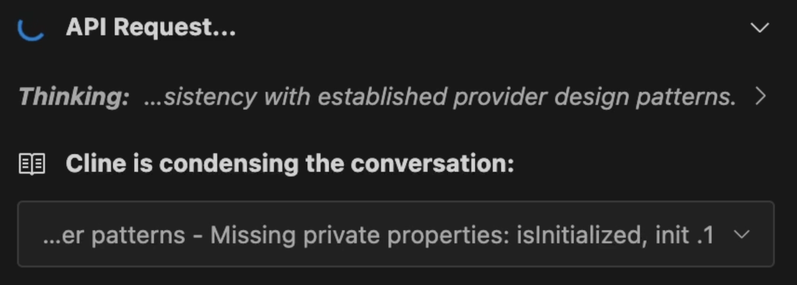

### 2.2 历史：官方 Task / Controller / Webview 图（只作对照）

#### `.clinerules/cline-overview.md` 架构总图 {#fig-official-historical}

- **来源：** [`.clinerules/cline-overview.md`](https://github.com/cline/cline/blob/4cdfb19a5e897b9e75827cbb4f280f322e27e44a/.clinerules/cline-overview.md)（blob 页 2026-11-18 HTTP 200；内容按钉选提交读取）
- **作者 / 日期：** 仓库内这份规则文档仍存在于钉选提交；它描述的是 Extension Host 内的 `WebviewProvider`、`Controller`、`Task`（`src/core/task/index.ts`）、MCP Hub 与 Webview `postMessage`
- **时代：** **旧 Task 循环**（官方文件，但是历史阅读地图）
- **属性：** 官方，但**过时作为“当前主循环”**
- **用途：** 只用来回答“网上为什么还在讲 Task 类”。与第 2.1 节主图对放时，必须口头标明时代。
- **限制：** 即使文件还在 `main` 的这个提交里，也不能据此断言 VS Code 宿主今天仍以该图为运行时主干。当前阅读入口是 SDK 分层与宿主装配。
- **本地副本：** `cline-sharing-assets/official/historical-task-webview.svg`


### 2.3 第三方：v4.1.22 / AgentRuntime 解剖（推荐作第二张图的来源）

来源页：[Agent Harness Anatomy #3: Cline](https://dpsm.github.io/agent-harness-anatomy/cline/)（2026-11-18 HTTP 200）。**作者：** David P. S. Marques（页面 `<meta name="author">`）。**钉选：** tag `v4.1.22` → `f58bc118bdeef1bd2813cd08e00d98bdcda96475`（页面写明 2026-09-29）。范围写明覆盖 VS Code 扩展，桌面应用不在范围内。以下 SVG 均从该页 `figures/` 原样下载，不是重绘。

这些图属于**新 AgentRuntime 分层**下的第三方精读，比自动生成总图更适合讲机制；但仍是作者对 v4.1.22 的解读，细节要以钉选提交的源码为准（本包钉的是更新的 `4cdfb19a…`）。

| 本地文件 | 页面 alt / 标题 | 描绘 | 分享用途与限制 |
|---|---|---|---|
| `dpsm/cline.svg` | Cline architecture | 交互式总图（页面邀请 pan/zoom/click） | 结构总览；信息密度高，现场不宜当第一张主图 | 
| `dpsm/seq-bridge.svg` | Host-webview bridge | 宿主与 webview 桥 | 讲 IDE 宿主装配时可用；不要和旧 `postMessage` 总图混用 |
| `dpsm/seq-approval.svg` | Approval model | 工具调用 → policy gate → 回调 / webview → 反馈 | **推荐第二张图** |
| `dpsm/seq-checkpoint.svg` | Checkpoint system | 检查点 | 第 4–5 章恢复话题 |
| `dpsm/seq-plugin-lifecycle.svg` | Plugin lifecycle and the 7-callback hook bag | 插件与 hook | 对 SDK 听众有用 |
| `dpsm/seq-user-hooks.svg` | File-based user hook firing | 基于文件的用户 hook | 可与 #14962（TaskCancel 未触发）对照 |
| `dpsm/seq-skills.svg` | Skills tool invocation | Skills 调用 | 次要 |
| `dpsm/seq-slash-commands.svg` | Slash-command expansion: two semantics | 斜杠命令两种语义 | 次要 |
| `dpsm/seq-mcp-tool-call.svg` | Runtime MCP tool call | 运行时 MCP 工具调用 | 与 #15738 / #15574 对照 |
| `dpsm/seq-subagent.svg` | spawn_agent delegation | 子智能体委派 | 第 4–5 章委派 |

#### Approval 序列图（推荐投影） {#fig-dpsm-approval}

图题原文为 “Approval: tool call -> policy gate -> webview -> feedback”。图内说明（作者原文，不是本包的测试结论）：VS Code 对受治理工具强制 `autoApprove: false`；读/改默认自动批准，命令默认询问。这是 v4.1.22 解剖中的观察，宿主与默认值会变，引用时带上版本。

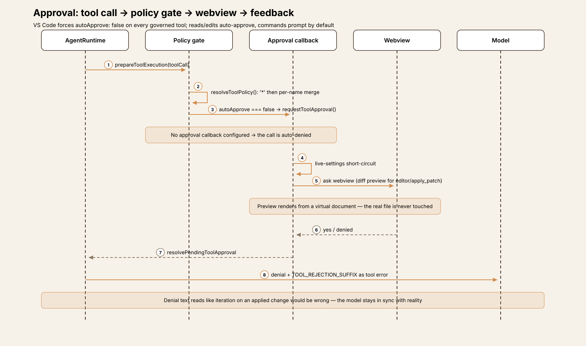

#### 架构总图与其余序列图 {#fig-dpsm-arch}

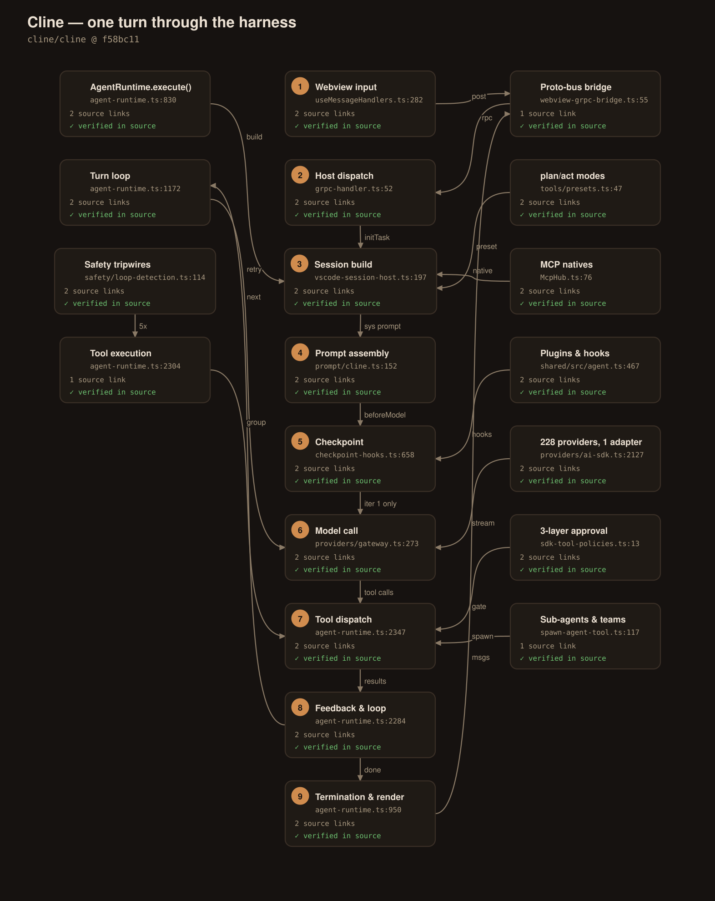

其余序列图按需查阅同一目录，此处不逐张展开，以免冲淡主图。HTML 版在本节后附全部缩略图。

### 2.4 第三方与社区图（混合 / 历史 / 自动生成）

#### AIGC Camp《Cline 源码剖析》 {#fig-aigccamp-arch}

- **来源：** [aigccamp.com/source/cline](https://aigccamp.com/source/cline)（2026-11-18 HTTP 200）
- **作者：** 页面未标注个人作者（站点为 AIGC Camp / Agent Camp）
- **日期：** 文中写“基于 2026 年中 cline/cline 主仓库”；无更精确的发表日
- **描绘：** 两张可提取 mermaid：一张是 VS Code UI → Webview → `Task` → `recursivelyMakeClineRequests` → XML 解析 → ToolExecutor / LoopDetection / CommandPermission / ContextManager；一张是同路径的 Plan→Act 时序。正文另有第 5 节讨论 `AgentRuntime`（文中写 `agent-runtime.ts` 1544 行），但**没有**单独的 AgentRuntime mermaid。
- **时代：** **混合**（主图仍是旧 Task 循环；文字承认双层并存）
- **用途：** 讲“为什么网上还在画 Task 类”，以及 Loop Detection / Command Permission 的讨论。不要当当前主图。
- **限制：** 文中有“XML 比 native function calling 大约多消耗 30–50% input token”等量化判断，这是该文的说法，**本包未复测**，分享时不要当成测量结论。Task 类“3764 行”等行号以该文当时仓库为准，不必与钉选提交逐行相等。
- **本地副本：** `cline-sharing-assets/community/aigccamp-architecture.svg`、`…/aigccamp-sequence.svg`


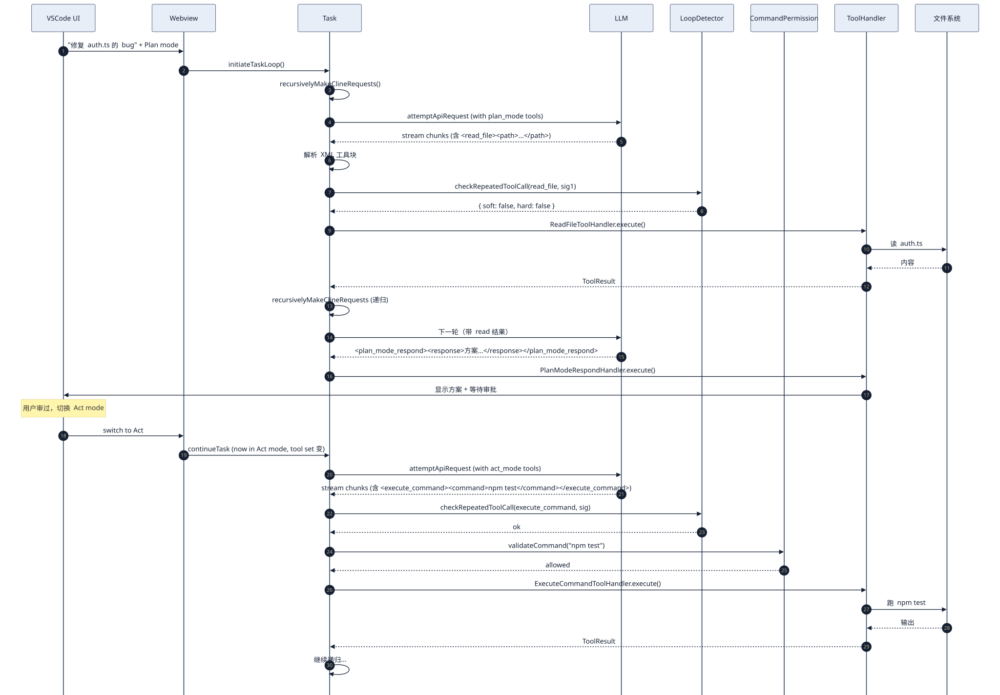

#### SeongHwa Lee，2026-06-30 {#fig-martianlee-big}

- **来源：** [martianlee.github.io/posts/2026-06-30-cline-architecture](https://martianlee.github.io/posts/2026-06-30-cline-architecture)（2026-11-18 HTTP 200）
- **作者 / 日期：** 页面署名 SeongHwa Lee，标注 Jun 30, 2026；并写 “Study note · analyzed with AI”
- **描绘：** 两张 mermaid。一张是 React webview 与 CLI 经 ProtoBus 进入 “Cline core（task / controller / api / context）”，再进入 “Task loop: LLM → tool → human approval → result”；一张是 ProtoBus / HostBridge 把核心从编辑器宿主拆开。
- **时代：** **混合**（已有宿主抽象与 `@cline/llms`，循环仍标为 Task loop）
- **用途：** 讲“核心如何从 IDE 拆出”的过渡期视角；与当前分层图对照很有用。
- **限制：** 作者标明使用了 AI 辅助分析。日期早于 v4.1.22 解剖和本包钉选提交。
- **本地副本：** `cline-sharing-assets/community/martianlee-big-picture.svg`、`…/martianlee-host-abstraction.svg`



#### GitDiagram 自动生成总览 {#fig-gitdiagram}

- **来源：** [gitdiagram.com/cline/cline](https://gitdiagram.com/cline/cline)（2026-11-18 HTTP 200；页面为 JS 应用，静态 HTML 只有 “Loading diagram”。本轮用只读抓取得到其 Markdown 版，内含完整 mermaid，并写明 *last updated 2026-10-12*）
- **作者：** 站点页脚为 “Made by Ahmed Khaleel”；图本身是产品自动生成
- **日期：** 2026-10-12（来源页原文）
- **描绘：** CLI / Agent core / Editor / Hub 四个分组的概览。页面自己的警告是：由文件树、README 和源码采样生成，“It is an AI-made overview: check details against the source.” 并把 Agent runtime 指向 `sdk/packages/core/src/runtime/host/runtime-host.ts`（这是 **RuntimeHost**，不是 `@cline/agents` 里的 `AgentRuntime` 类——引用时要说清这个命名容易混）。
- **时代：** **自动生成概览**
- **用途：** 给完全陌生的听众看“仓库里有哪些子系统”；不要用虚线去讲真实控制流。
- **限制：** 多条边被标成未完全核验的接线。交互式页面未能在无 JS 条件下截到位图，本地图是按其公开 mermaid 重绘。
- **本地副本：** `cline-sharing-assets/community/gitdiagram-overview.svg`


#### Plan/Act 工作流（qingwave，2025-12-02） {#fig-qingwave}

- **来源：** [qingwave.github.io/cline-prompt/](https://qingwave.github.io/cline-prompt/)（2026-11-18 HTTP 200；页面标注 Dec 2, 2025）。同类流程图亦出现在 [掘金帖](https://juejin.cn/post/7580180556982747186)（2026-11-18 HTTP 200）。
- **作者：** 站点为 qingwave.github.io；页面未在本轮摘到独立的真名署名，故作者标为该站点；掘金转载作者未在未打开的作者页上另行核实
- **描绘：** 从消息组装到 Plan / Act、审批、`task_progress`、`attempt_completion` 的**提示词级工作流**，不是 SDK 包图。
- **时代：** 偏旧 Task / 产品工作流（工具名仍是 `plan_mode_respond`、`attempt_completion`）
- **用途：** 讲 Plan/Act 在用户与提示词层是怎样被叙述的；不要当成 2026-11 的运行时结构。
- **限制：** “每次只调用一个工具”等是该文对当时提示词规范的概括，不一定等于当前运行时仍强制串行。
- **本地副本：** `cline-sharing-assets/community/qingwave-plan-act.svg`


### 2.5 有页面、但本轮未能捕到可嵌入图的来源

| 页面 | HTTP（2026-11-18 Asia/Shanghai） | 说明 |
|---|---|---|
| [deepwiki.com/cline/cline/13.2-agent-api-and-clinecore](https://deepwiki.com/cline/cline/13.2-agent-api-and-clinecore) | **429**，标题为 Vercel Security Checkpoint（23:08:25 起多次同样结果） | 已知起点。未能取得图。搜索另外给出标题相近的 [13.2-agent-runtime-and-session-orchestration](https://deepwiki.com/cline/cline/13.2-agent-runtime-and-session-orchestration)；该 URL 未在无检查点的情况下打开，**不要把搜索摘要里的结构描述当成已核图**。分享前可再试。 |
| [cline-book.myhubs.dev](https://cline-book.myhubs.dev/) 及 [目录](https://cline-book.myhubs.dev/contents.html)、抽样章节 | 站点与抽查章节均为 **200** | 标题《Cline 源码解析》。章节结构以 Extension / Controller / **Task 主循环** / ToolExecutor / ContextManager 为主，属于**旧路径**。本轮打开的章节 HTML **没有**可提取的 mermaid 或内容图（仅有导航图标）。GitHub 仓库 [coolclaws/cline-book](https://github.com/coolclaws/cline-book) 仅有一次提交：`8ac671ef75`，说明为 “init: Cline 源码解析电子书”，时间为 2026-03-16T19:58:30Z = **2026-03-17 03:58:30 Asia/Shanghai**，作者登录名为 `coolclaws`。站点页脚写 “Copyright © 2025-present” 且自称 MIT，但 GitHub 的 `license` 字段为 null——二者不一致，引用时并列注明。 |
| [掘金：Cursor 开源平替 Cline 到底是如何实现的](https://juejin.cn/post/7472317661177069594) | **200** | 搜索摘要中含 ClineProvider / Cline.ts 等 mermaid，属**旧 Task 时代**。本轮未另存其 mermaid（避免把未核对的摘要图当作已捕获）。可作链接备查。 |

官方 docs 页面本身是 Mentlify/JS 站点，本轮没有从 HTML 里拆到独立的架构 SVG（除 Auto Compact 配图和 logo）。上面的官方图来自仓库 mermaid 或对官方 ASCII/PR 文本的重绘。

---

## 3. 社区问题地图

这里收集的是**反复出现的问题主题**，不只是 Issue 列表。材料包括：钉选提交里的官方 gotchas、GitHub Issue、官方文档，以及 Reddit r/CLine 的公开讨论（后者在本环境对 reddit.com 的 HTTP 抓取 20 秒超时，标题与部分评论来自 2026-11-18 的公开搜索结果，引用已标明）。没有登录 Discord，故**没有** Discord 材料。中文社区方面，AIGC Camp 文有“局限与坑”一节；V2EX 本轮没有找到可引用的、带图或带复现细节的独立主帖。

不要把“有 Issue / 有讨论”写成“发生频率很高”。下面每条都给出 2–4 个公开链接、维护者或贡献者是否表态、已知状态，以及可以带进分享的**工程课**。并尽量区分：产品缺陷、预期设计、用户配置、第三方 provider 行为。

### 3.1 上下文窗口、Auto Compact 与“撞墙无法恢复”

**用户在说什么：** 对话接近或超过模型窗口时，自动压缩没有及时发生、发生得过早、在设置关闭后仍发生，或一旦出现 `Prompt is too long` / `request exceeds the context window`，同一任务无法恢复。官方产品文档 [Auto Compact](https://docs.cline.bot/features/auto-compact) 的用户可见叙述是：接近窗口时做摘要并替换历史；并写明对其它模型可能回退到基于规则的截断。官方 gotchas（[`clinecore/gotchas.md`](https://github.com/cline/cline/blob/4cdfb19a5e897b9e75827cbb4f280f322e27e44a/.agents/skills/cline-sdk/references/clinecore/gotchas.md)）则把长会话压缩视为 SDK 侧应配置的问题，并提醒 `Agent` 会把消息全部留在内存里。

**公开讨论举例：**

- [#15661](https://github.com/cline/cline/issues/15661)（closed / completed，提问者关闭）——见第 1.2 节。
- [#10637](https://github.com/cline/cline/issues/10637)（open，标 `stale`）：报告在关闭 autocompact 后仍被静默压缩；评论里有人将其与 OpenAI-compatible + DeepSeek 路径把窗口写成 128k 联系起来。这是**用户报告 + 社区代码阅读**，本轮未见维护者在该帖确认根因。
- [#9181](https://github.com/cline/cline/issues/9181)（open）：`opus-4.6:1m` 上压缩过于激进。标 `Investigation Needed`。
- [#7164](https://github.com/cline/cline/issues/7164)（closed / completed，@ClineXDiego 于 2026-02-13 04:55:47 Asia/Shanghai 关闭）：单次过大输入导致 413 后整个会话无法恢复。贡献者 @Garoth 曾回复会查看；自动化分析评论指出，若**单条消息**本身超过窗口，截断策略帮不上忙。
- [#9748](https://github.com/cline/cline/issues/9748)（closed / completed，@ClineXDiego 于 2026-03-21 05:34:53 Asia/Shanghai 关闭）：LiteLLM 上界面显示 1M，内部按 200K 处理，过早摘要。这更接近**产品目录 / 适配配置**问题，而不是“压缩算法随机失效”。
- Reddit：[Cline condenses context disrupting tasks](https://www.reddit.com/r/CLine/comments/1n1gg7t/cline_condenses_context_disrupting_tasks/) 与 [What happened to context compression every 6 prompts?](https://www.reddit.com/r/CLine/comments/1np8vjk/what_happened_to_context_compression_every_6/)（本环境 curl 超时）。搜索摘要中，用户 u/nick-baumann 称压缩阈值在超过约 80% 窗口时触发，并区分 Auto Compact 与 Focus Chain；还指向官方 Auto Compact 文档。该身份是否为官方人员，本包不作额外断言。

**工程课：** 压缩触发条件、token 预估、provider / 本地服务器的硬限制，是三个时钟。预估未到阈值、或本回合因工具输出一次性超限，都会让“自动压缩”表现为没发生。反过来，目录里的窗口大于内部使用的窗口，会表现为压缩过早。讲稿里应写成可测试的不变式：自动压缩必须在**即将发出的请求**上做预算，而不是只看上一回合结束时的用量。

### 3.2 CLI / UI 在窗口满或长编辑时挂起、冻结

**用户在说什么：** 窗口满了只看到无法操作的 Retry；长文件编辑过程中界面停住，Cancel 后再来一遍；命令无输出时 UI 锁死。这可能是产品缺陷，也可能是宿主把执行和 UI 放在同一进程里的结构性后果——官方 Hub-Spoke 文档正是以“避免 runaway agent 冻住 UI”为动机之一。

**公开讨论举例：**

- [#9323](https://github.com/cline/cline/issues/9323)（open，`stale`，CLI）：上下文满后有 Retry 文案，但 CLI 无法点，只能 Exit。2026-04-17 仅有 stale 机器人评论，未见维护者方案。
- [#694](https://github.com/cline/cline/issues/694)（closed / completed，@celestial-vault 于 2025-06-22 03:49:37 Asia/Shanghai 关闭）：安静的长时间命令导致 UI 锁死、无法开新会话。这是**已关闭的历史报告**，用来说明问题存在过，不要直接当成 4.1.x 仍未修。
- Reddit：[Does Cline keep hanging/freezing almost every other time it's editing a java file?](https://www.reddit.com/r/CLine/comments/1qj2os4/does_cline_keep_hangingfreezing_almost_every/)（curl 超时）。搜索摘要中，发帖者描述编辑或写文件将完成时挂起，必须 Cancel；回复中有人认为与 VS Code 更新或长对话有关，并称换模型后仍出现。这些是用户报告，不是维护者结论。

**工程课：** 错误恢复动作（Retry、Compact、Cancel）必须在**当前宿主的实际输入通道**里可及。只在 Webview 按钮上提供、在 CLI 或冻结 UI 里不可达，等于没有恢复。Hub-Spoke 把执行移出 UI 进程，是针对这类问题的架构回答，但是否覆盖所有宿主默认路径，要以 `backendMode` 和具体版本为准。

### 3.3 审批被绕过、拒绝未持久、Plan 模式仍能写

**用户在说什么：** 点了 Reject，模型换一种方式再执行且不再询问；Plan 模式或关闭编辑权限后仍能改文件；MCP 的 per-server `autoApprove` 列表写了但不生效；CLI 的“全部自动批准”压过插件 `beforeTool` 的 `autoApprove: false`。官方文档 [Permission Handling](https://docs.cline.bot/sdk/guides/permission-handling) 写明未列出的工具**默认启用且自动批准**，并警告全自动批准只适用于受控环境。官方 gotchas 另有一条关键预期设计：`requestToolApproval` **若回调永不 resolve，会话会挂起**——应在回调里做超时，或在流水线里全部 `autoApprove: true`。

**公开讨论举例：**

- [#10783](https://github.com/cline/cline/issues/10783)（closed / `not_planned`，`linear-code[bot]` 于 2026-11-06 17:37:00 Asia/Shanghai 关闭）：Reject 后再次执行且未再询问。评论区有架构性讨论（拒绝应写入上下文**并且**由执行器强制），但作者关联为 `NONE`，**不能当成维护者确认**。关闭没有公开理由。
- [#15738](https://github.com/cline/cline/issues/15738)（open）——贡献者已确认，见第 1.2 节。同类报告还见于 [#13140](https://github.com/cline/cline/issues/13140)（open）：v4.x SDK 迁移后 Plan 模式不尊重编辑权限。
- [#15574](https://github.com/cline/cline/issues/15574)（open，VS Code 4.1.26 / 当时 `main`）：per-server `autoApprove` 被 schema 接受并写到工具对象上，但审批链不消费；提问者后续澄清 UI 里的 per-tool 开关实际被特性开关关掉，真正的缺陷是配置列表未进入审批链。尚无维护者结论文本；有人申请认领。
- [#15645](https://github.com/cline/cline/issues/15645)（open）：CLI 默认“auto-approve all”压过插件 `beforeTool` 给出的 `{ autoApprove: false }`。评论中有人复现并请示是否可动手修。
- 官方 gotchas：[`requestToolApproval` Blocks Execution](https://github.com/cline/cline/blob/4cdfb19a5e897b9e75827cbb4f280f322e27e44a/.agents/skills/cline-sdk/references/clinecore/gotchas.md)

**分类提示：** “未列入 policy 的工具默认自动批准”是**文档写明的预期设计**，容易被当成缺陷。Plan 模式仍能经 MCP 写入、以及配置列表未被审批链消费，则是把“模式 / 配置”和“执行器强制”之间的缝暴露出来，更接近产品缺陷或未完成的迁移。`requestToolApproval` 不超时会挂起，是官方已经写明的集成陷阱。

**工程课：** 拒绝必须同时进入（1）模型上下文，以免下一回合当成空白世界；（2）执行器，以免换一种调用方式就绕过。超时的审批回调必须有出口，否则“等待用户”会变成“悬挂的会话”。模式开关若只隐藏某一类内置工具、却放行同效果的 MCP 工具，分类泄漏就会否定模式不变量。钉选提交含 #15381（携带 MCP tool annotations 与 session mode），贡献者说明它还**不改变**上述 Plan 模式行为——适合作为“正在补分类信息、行为尚未跟上”的例子。

### 3.4 命令超时、取消与“停止后仍继续”

**用户在说什么：** 命令还在跑，工具却在约 30 秒后报失败；智能体据此重试或改道。取消或 Stop 之后，钩子没跑，或下一句输入把已停止的生成续上。官方 Agent gotchas 要求长工具尊重 `abortSignal`，并提醒 `run()` 第二次会重置对话（应使用 `continue()`）。

**公开讨论举例：**

- [#10549](https://github.com/cline/cline/issues/10549)（open）——见第 1.2 节。
- [#7355](https://github.com/cline/cline/issues/7355)（open，JetBrains）：不等待终端命令结束。有一条分析评论将其与默认 30 秒超时、以及 JetBrains 下终端设置 UI 不可见联系起来（评论来自 `github-actions[bot]` 的根因分析，应标明来源，不宜直接当成已合并修复）。
- [#14962](https://github.com/cline/cline/issues/14962)（open）：CLI 按 Esc 停止时跑了 `SessionShutdown`，没有跑 `TaskCancel`。Issue 正文给出了具体机制：`AgentRuntime` 在中止时返回 `status: "aborted"` 且 `error` 为 `undefined`，后续 `isAbortReason(undefined)` 为假。评论中有人开了 PR #14980；**本轮未核该 PR 是否已合并**。
- [#14702](https://github.com/cline/cline/issues/14702)（open，Desktop）：界面上停止像成功了，后续一句却把停掉的回答继续写下去。
- [#10139](https://github.com/cline/cline/issues/10139)（open）：遇到带长 `retry-after` 的 429 时仍重试，而不是把 WAIT 与 STOP 区分开。

**工程课：** 工具协议必须区分“过程仍在运行但等待结束”“过程失败”“用户取消”。`status: "aborted"` 若没有可识别的 reason，下游钩子会静默走错分支。这与讲稿中的 timeout ≠ cancel、stop ≠ success 直接对齐。

### 3.5 MCP、Provider 与 Token / 窗口元数据

**用户在说什么：** MCP 工具目录把提示词撑大；OAuth 状态机显示已授权但受保护调用仍 401；模型目录里的窗口 / 免费标签与实际计费或服务器限制不一致。部分是第三方 provider 或 MCP 服务器行为，部分是客户端状态机。

**公开讨论举例：**

- [#15574](https://github.com/cline/cline/issues/15574)、[#15738](https://github.com/cline/cline/issues/15738)（上节，MCP 与审批）。
- [#15752](https://github.com/cline/cline/issues/15752)（open，2026-11-18 仍有更新）：CLI 对可公开发现的 MCP 显示已授权，受保护工具仍要求 OAuth。这是状态机一致性问题，不宜在未读正文的情况下扩写成“安全突破”。
- [#10410](https://github.com/cline/cline/issues/10410)（open）：ChatGPT 订阅 / gpt-5.5，Cline 认为窗口是 1M，约 500k 就失败。偏向 **provider 实际限制 vs 产品展示的窗口**。
- [#8074](https://github.com/cline/cline/issues/8074)（open，曾 reopened）：界面标为 FREE 的模型仍扣额度——属于计费 / 标签，不是运行时循环本身。
- 官方 gotchas：插件要声明 capabilities；`enableTools` 必须显式打开，否则内置工具不可用——这是集成配置问题。

**工程课：** 把“目录里的窗口 / 价格 / 授权状态”和“这一次请求真正用到的约束”分成两份数据。MCP 工具一旦进入默认自动批准或 Plan 模式的可用集合，它们就不再是插件边角，而是执行面的一部分。

### 3.6 Plan/Act 切换的产品与性能问题

**用户在说什么：** 模式一切，系统提示词和工具集变化，本地 LLM 的前缀缓存作废；未发送的输入被清掉；JetBrains 上 Plan 模式要先按 Cancel 才能回答问题。

**公开讨论举例：**

- [#15641](https://github.com/cline/cline/issues/15641)（open，标题自标 `[Design]`）：Plan/Act 切换导致本地 LLM 的 prompt / KV cache 失效。讨论偏设计取舍，不是简单的“改一个 flag”。
- [#9453](https://github.com/cline/cline/issues/9453)（open）：Plan 切到 Act 清掉未发送文本。
- [#8838](https://github.com/cline/cline/issues/8838)（open，JetBrains）：Plan 模式不先 Cancel 就无法回答。
- 历史缺陷 [#5113](https://github.com/cline/cline/issues/5113)（closed / completed，@saoudrizwan 于 2025-07-25 14:08:40 Asia/Shanghai 关闭）：切到 Plan 模式时删文件。这是**已关闭的严重历史问题**，用来说明模式切换曾触及危险副作用；不要说成当前版本仍必现。

**工程课：** 模式是提示词与工具集的投影，也会打断缓存、丢掉未提交 UI 状态、甚至走过破坏性路径。若把“Plan”当作安全保证，必须有执行器级的工具分类（回到 3.3）。

### 3.7 破坏性命令、检查点与终端可靠性

**用户在说什么：** 引号在 Windows / PowerShell 下被破坏，导致危险删除；检查点恢复弄丢未跟踪文件；偶尔删掉 `.git`；终端输出抓不稳。这类问题有的是产品缺陷，有的是 shell 转义与工作目录约定，有的需要更多复现信息。

**公开讨论举例：**

- [#14864](https://github.com/cline/cline/issues/14864)（open）：Windows 上 `run_commands` 引号被破坏，`rmdir /s /q` 打到盘符根。作者标为 CRITICAL。
- [#14367](https://github.com/cline/cline/issues/14367)（open，2026-11-17 仍更新）：检查点恢复在 `git clean -fd` 前改写了未提交的 `.gitignore`，永久删掉未跟踪文件。
- [#8273](https://github.com/cline/cline/issues/8273)（open，标 Needs User Input / Investigation Needed）：有时删除整个 `.git`。维护者侧需要更多输入，不宜在分享里当成已证实的必现缺陷。
- [#4356](https://github.com/cline/cline/issues/4356)（open，曾 reopened，66 条评论）：跨平台终端集成可靠性。评论多，适合附录，不适合作为 1 分钟架构案例。

**工程课：** 工具参数的“模型字符串”和“shell 真正执行的 argv”之间必须有可审计的边界。检查点如果依赖 git clean，就必须先讲清楚忽略规则与未跟踪文件的命运。

### 3.8 成本、模型能力与产品文案

[#5915](https://github.com/cline/cline/issues/5915)（open，62 条评论）反对产品里“建议使用 Claude”的推销文案，并涉及较弱模型难以消化复杂提示词与多步任务。这更多是产品与模型质量，不是运行时协议本身。[#7262](https://github.com/cline/cline/issues/7262)（open）报告大型写入或解析时反复出现空 / 不可解析的 API 响应——需要先分清是 provider 返回空，还是客户端解析失败。不要用评论数推导严重程度。

AIGC Camp 文把 XML 协议的 token 开销列为局限；这是第三方估计。官方 gotchas 则提醒：工具 `execute` 若抛异常会记入 mistake，过多会以 `mistake_limit` 结束——应返回结构化错误。这也是“停止原因必须可区分”的一部分。

---

## 4. GitHub Issue 摘要

### 4.1 仓库体量快照（仅 API，带时间）

查询时刻：**2026-11-18 23:08:08–23:08:10 Asia/Shanghai**（`gh api`，只读）。

| 指标 | 值 | 来源与限制 |
|---|---|---|
| `open_issues_count` | **1793** | `GET /repos/cline/cline`。GitHub 此项**包含未关闭的 PR**，不能当成“开放 Issue 数”。同响应还给出 `stargazers_count` 71751、`forks_count` 7937、`pushed_at` 2026-11-17T21:45:55Z = 2026-11-18 05:45:55 Asia/Shanghai、`updated_at` 2026-11-18T14:20:22Z = 2026-11-18 22:20:22 Asia/Shanghai。 |
| 仅开放 Issue | **934** | 搜索 `repo:cline/cline is:issue is:open`，`incomplete_results=false`。这是 Search API 的 `total_count`，可能与 Issue 列表有短暂滞后。本轮每种排序只取了第 1 页。 |

**本轮使用的检索（均为 `is:issue` 由 Search API 保证；`per_page` 与 `page=1` 如下；目标检索时段 2026-11-18 23:08:19–23:08:33 Asia/Shanghai）：**

| 查询 | sort / order | per_page | total_count | incomplete | 实际取回 |
|---|---|---|---|---|---|
| `repo:cline/cline is:issue is:open` | comments / desc | 50 | 934 | false | 50（第 1 页，不是全部） |
| `repo:cline/cline is:issue is:open` | updated / desc | 50 | 934 | false | 50 |
| `repo:cline/cline is:issue is:open label:bug` | updated / desc | 30 | **18** | false | 18（全部）。注意大量缺陷**没有** `bug` 标签，18 不能当开放缺陷总数 |
| `repo:cline/cline is:issue approval` | comments / desc | 30 | 186 | false | 30 |
| `repo:cline/cline is:issue "context window"` | comments / desc | 30 | 606 | false | 30。该词很宽，结果里混有大量并不以窗口管理为主题的帖 |
| `repo:cline/cline is:issue compact OR compaction` | comments / desc | 30 | 196 | false | 30 |
| `repo:cline/cline is:issue hang OR hanging OR hung` | comments / desc | 30 | 201 | false | 30 |
| `repo:cline/cline is:issue freeze OR frozen` | comments / desc | 20 | 147 | false | 20 |
| `repo:cline/cline is:issue MCP` | comments / desc | 30 | 598 | false | 30 |
| `repo:cline/cline is:issue YOLO` | comments / desc | 20 | 55 | false | 20 |
| `repo:cline/cline is:issue "plan mode"` | comments / desc | 30 | 429 | false | 30 |
| `repo:cline/cline is:issue subagent OR sub-agent` | comments / desc | 20 | 51 | false | 20 |
| `repo:cline/cline is:issue timeout` | comments / desc | 20 | 315 | false | 20 |
| `repo:cline/cline is:issue cancel OR cancellation OR abort` | comments / desc | 20 | 340 | false | 20 |

因此：下面的短名单来自这些页面、已知起点 Issue，以及与架构课相关的交叉阅读，**不是** 934 条的全量排序，也不是按“重要性”自动打分。

时间换算约定：GitHub 的 `Z` 时间均转为 Asia/Shanghai 并标注时区。评论数是拉取该 Issue 对象时的 `comments` 字段。

### 4.2 分享用短名单（按主题，约 24 条）

#### A. 上下文、压缩与窗口元数据

**[#15661](https://github.com/cline/cline/issues/15661) — VSCode: request exceeds the context window**  
状态：closed / completed · 创建 2026-11-11 22:44:38 Asia/Shanghai · 更新 / 关闭 2026-11-13 22:02:09 Asia/Shanghai（提问者关闭）· 评论 3 · 标签 VS Code  
摘要：Cline 4.1.26 上请求超过上下文窗口，提问者期望 Auto Compact 先发生。评论区一条说明把原因归结为预请求估计与本地服务器硬限制的时机 / 算法错位；提问者致谢后关闭。  
**为何值得讲：** 见 1.2。不要把 completed 自动解释成代码已修。

**[#9323](https://github.com/cline/cline/issues/9323) — Cline CLI hangs when context window is full - no accessible retry button**  
状态：open（`stale`, CLI）· 创建 2026-02-15 04:06:41 Asia/Shanghai · 更新 2026-04-17 10:14:26 Asia/Shanghai · 评论 3  
摘要：CLI 在窗口满时给出带 Retry 的说明，但可操作项只有退出。更新记录是 stale 机器人。  
**为何值得讲：** 恢复动作必须在当前宿主可及。

**[#10637](https://github.com/cline/cline/issues/10637) — Cline auto compacts context silently even with autocompacting setting disabled**  
状态：open（`stale`, VS Code）· 创建 2026-05-11 22:26:23 Asia/Shanghai · 更新 2026-10-30 09:53:44 Asia/Shanghai · 评论 11  
摘要：多人报告关闭自动压缩后仍被压缩，或窗口被写成 128k。讨论停留在社区对特定 provider 路径的阅读。  
**为何值得讲：** “设置关闭”若没有落到同一条压缩决策链，用户会看到策略失效。

**[#9181](https://github.com/cline/cline/issues/9181) — Agressive context compaction with opus-4.6:1m**  
状态：open（Investigation Needed, VS Code）· 创建 2026-02-08 20:30:00 Asia/Shanghai · 更新 2026-09-24 23:37:52 Asia/Shanghai · 评论 10  
摘要：在标称 1M 的 Opus 配置上压缩过于频繁。  
**为何值得讲：** 与“压缩过晚”相对的另一极：触发阈值与模型真实窗口不一致。

**[#4389](https://github.com/cline/cline/issues/4389) — Improve Context Window Management and Large File Handling**  
状态：open · 创建 2025-06-23 13:09:17 Asia/Shanghai · 更新 2026-11-15 06:45:37 Asia/Shanghai · 评论 25 · 作者 @celestial-vault  
摘要：长期跟踪大文件与窗口管理导致的不可恢复错误和超额 token。更像史诗级改进，而不是单点 bug。  
**为何值得讲：** 说明该主题在仓库里是持续问题，而不是 2026 年才出现。

**[#13263](https://github.com/cline/cline/issues/13263) — Cline truncates tool output & file content in context**  
状态：open（VS Code）· 创建 2026-08-15 06:01:12 Asia/Shanghai · 更新 2026-11-05 00:47:38 Asia/Shanghai · 评论 27  
摘要：Message Builder 静默截断工具输出和文件内容，用户不得不手工切块，并希望限额可配置。  
**为何值得讲：** 发给模型的上下文是投影，不是文件系统的忠实拷贝；截断策略本身会改变智能体行为。

**[#10410](https://github.com/cline/cline/issues/10410) — gpt-5.5 fails when context reaches 500k, even though Cline believes the max context is 1M**  
状态：open（VS Code）· 创建 2026-04-26 05:08:38 Asia/Shanghai · 更新 2026-09-12 06:56:16 Asia/Shanghai · 评论 14  
摘要：产品侧窗口与 provider 实际可接受长度不一致。  
**为何值得讲：** 属于第三方限制 vs 目录数据，不要先归因为压缩 bug。

**[#9748](https://github.com/cline/cline/issues/9748) — Claude Sonnet 4.6 via LiteLLM: displays 1M but internally treats it as 200K**  
状态：closed / completed · 创建 2026-03-10 12:54:52 Asia/Shanghai · 关闭 2026-03-21 05:34:53 Asia/Shanghai（@ClineXDiego）· 评论 9  
摘要：界面 1M、内部 200K，约 100K 就开始警告并摘要。本轮未另拉评论页。  
**为何值得讲：** 已关闭案例，说明窗口元数据错误会表现为“压缩过早”。

**[#7164](https://github.com/cline/cline/issues/7164) — 413 Error: No way to recover from 'Prompt is too long'**  
状态：closed / completed · 创建 2025-10-30 03:47:03 Asia/Shanghai · 关闭 2026-02-13 04:55:47 Asia/Shanghai（@ClineXDiego）· 评论 10  
摘要：窗口错误后同一任务无法继续；贡献者曾确认会查看。分析评论指出单条超限时截断无效。  
**为何值得讲：** 历史课：溢出恢复必须处理“单条消息已经放不进去”。

#### B. 审批、权限与 Plan 模式执行面

**[#15738](https://github.com/cline/cline/issues/15738) — Plan Mode 下经 MCP `apply_patch` 改文件**  
状态：open（JetBrains）· 创建 2026-11-16 07:36:38 Asia/Shanghai · 更新 2026-11-16 20:59:01 Asia/Shanghai · 评论 2  
摘要与贡献者确认见 1.2。  
**为何值得讲：** 当前最干净的“模式 vs 工具分类”案例。

**[#15574](https://github.com/cline/cline/issues/15574) — per-server autoApprove 列表未被审批链消费**  
状态：open（VS Code）· 创建 2026-11-06 18:19:12 Asia/Shanghai · 更新 2026-11-16 13:32:04 Asia/Shanghai · 评论 3 · 版本 4.1.26 / 当时 `main`  
摘要：配置被接受但不生效；提问者修正了最初把 UI 开关当成复现步骤的描述。  
**为何值得讲：** 配置面与执行面脱节。

**[#15645](https://github.com/cline/cline/issues/15645) — CLI auto-approve all overrides plugin beforeTool policy**  
状态：open · 创建 2026-11-11 05:00:31 Asia/Shanghai · 更新 2026-11-13 10:43:57 Asia/Shanghai · 评论 2  
摘要：插件在 `beforeTool` 里要求询问，CLI 默认全自动批准仍直接执行。  
**为何值得讲：** 多层 policy 的优先级必须写清楚，否则 hook 只是假开关。

**[#10783](https://github.com/cline/cline/issues/10783) — Cline disregards required approval**  
状态：closed / not_planned · 创建 2026-05-15 22:55:15 Asia/Shanghai · 关闭 2026-11-06 17:37:00 Asia/Shanghai（`linear-code[bot]`）· 评论 5 · 版本 v3.83.0  
摘要：Reject 后再次执行且未再询问。无维护者结案说明。  
**为何值得讲：** 社区把“拒绝要同时进上下文和执行器”讲得很清楚，但本包不能把该关闭当作官方判决。

**[#13140](https://github.com/cline/cline/issues/13140) — Plan mode not respecting edit permissions after v4.x SDK migration**  
状态：open（VS Code）· 创建 2026-08-11 01:45:28 Asia/Shanghai · 更新 2026-10-02 03:37:36 Asia/Shanghai · 评论 15 · 版本 4.1.7  
摘要：SDK 迁移后 Plan 模式与任务质量问题；评论中同样出现“经 MCP 写入”的讨论。  
**为何值得讲：** 说明 15738 不是孤立的宿主个案。

**[#5113](https://github.com/cline/cline/issues/5113) — Cline Deletes Files When Switching to Plan Mode**  
状态：closed / completed · 创建 2025-07-23 12:53:20 Asia/Shanghai · 关闭 2025-07-25 14:08:40 Asia/Shanghai（@saoudrizwan）· 评论 23  
摘要：当时版本在切入 Plan 或取消任务时出现删文件报告，短时间内大量确认后关闭。  
**为何值得讲：** 已修复/结案的历史严重问题；用来提醒模式切换曾经碰到破坏性副作用，而不是指控当前版本。

#### C. 超时、取消、挂起与恢复

**[#10549](https://github.com/cline/cline/issues/10549) — run_commands 30s timeout with misleading error**  
状态：open（CLI, beta）· 创建 2026-05-05 15:29:26 Asia/Shanghai · 更新 2026-11-18 04:55:11 Asia/Shanghai · 评论 7  
摘要见 1.2。更新很近，仍开放。  
**为何值得讲：** timeout ≠ 失败。

**[#7355](https://github.com/cline/cline/issues/7355) — Cline does not wait for terminal command to finish**  
状态：open（JetBrains, P2, Investigation Needed）· 创建 2025-11-08 01:09:55 Asia/Shanghai · 更新 2026-09-26 10:51:54 Asia/Shanghai · 评论 18  
摘要：终端命令未完成就被当作结束 / 超时。有针对默认 30 秒超时与 JetBrains 设置可见性的分析评论。  
**为何值得讲：** 同一超时问题在不同宿主上的表现。

**[#14962](https://github.com/cline/cline/issues/14962) — TaskCancel hooks never run when a run is cancelled**  
状态：open（CLI, Bug）· 创建 2026-10-09 10:34:00 左右 Asia/Shanghai（Issue 对象 created_at 2026-10-09T02:33:51Z = 2026-10-09 10:33:51 Asia/Shanghai）· 更新 2026-10-09 22:20:42 Asia/Shanghai · 评论 2  
摘要：CLI 中止时 `error` 为空，导致取消钩子不被识别。有人提交 PR #14980。  
**为何值得讲：** 运行时状态枚举与钩子 reason 必须同一套词汇。

**[#14702](https://github.com/cline/cline/issues/14702) — A follow-up resumes the response that was stopped**  
状态：open（Desktop, QA, Bug）· 创建 2026-09-30 21:50:28 Asia/Shanghai · 更新 2026-10-01 00:17:44 Asia/Shanghai · 评论 2  
摘要：Stop 的 UI 反馈像成功，下一句却续写被停的生成。  
**为何值得讲：** “界面显示已停止”不是协议上的已中止。

**[#15632](https://github.com/cline/cline/issues/15632) — Resume after extension-host restart keeps a dead pid**  
状态：open（VS Code）· 创建 2026-11-10 11:18:08 Asia/Shanghai · 更新 2026-11-18 05:55:05 Asia/Shanghai · 评论 5 · 版本 4.1.26  
摘要：扩展宿主重启后 `sessions.pid` 仍是死进程，协调器在 failed 与 running 之间反复翻转。有独立确认（包括断电重启）。  
**为何值得讲：** 会话恢复与进程活性必须按同一版本的记录做比较，否则“恢复”会变成状态震荡。

**[#10139](https://github.com/cline/cline/issues/10139) — 429 with long retry-after retried instead of surfaced**  
状态：open（P2, VS Code, Bug）· 创建 2026-04-05 02:53:49 Asia/Shanghai · 更新 2026-06-23 01:49:15 Asia/Shanghai · 评论 5  
摘要：长 retry-after 的 429 被当成可重试错误，WAIT 与 STOP 不分。  
**为何值得讲：** 提供商的“请等待”不是运行时的“请再撞一次”。

#### D. 破坏性执行与检查点

**[#14864](https://github.com/cline/cline/issues/14864) — Windows PowerShell quoting led to rmdir against a drive root**  
状态：open（VS Code, Windows）· 创建 2026-10-06 23:21:33 Asia/Shanghai · 更新 2026-10-19 20:00:31 Asia/Shanghai · 评论 13 · 版本 4.1.22  
摘要：命令引号被破坏后出现针对盘符根的删除。  
**为何值得讲：** argv 边界是执行协议的一部分，不是 shell 小问题。

**[#14367](https://github.com/cline/cline/issues/14367) — Checkpoint restore … permanently deleting untracked files**  
状态：open（VS Code, CLI）· 创建 2026-09-22 06:22:43 Asia/Shanghai · 更新 2026-11-17 09:52:35 Asia/Shanghai · 评论 5  
摘要：恢复检查点时的 git clean 与 `.gitignore` 处理导致未跟踪文件永久丢失。  
**为何值得讲：** 恢复路径也是破坏性路径，必须有与“用户理解的检查点”一致的不变式。

**[#8273](https://github.com/cline/cline/issues/8273) — Cline sometimes deletes whole .git folder**  
状态：open（P2, Needs User Input）· 创建 2025-12-23 11:29:00 Asia/Shanghai · 更新 2026-10-01 17:15:58 Asia/Shanghai · 评论 14  
摘要：允许编辑后出现整个 `.git` 被删的报告；仍需更多用户输入。  
**为何值得讲：** 可作风险意识，但不要夸大成已证实的通用行为。

#### E. 设计层的 Plan/Act 与缓存

**[#15641](https://github.com/cline/cline/issues/15641) — Plan/Act mode switches break local-LLM prompt/KV caches**  
状态：open（VS Code，自标 Design）· 创建 2026-11-11 02:39:56 Asia/Shanghai · 更新 2026-11-16 20:30:48 Asia/Shanghai · 评论 11 · 版本 4.1.26  
摘要：两种模式序列化出不同的系统提示词和工具集，本地 LLM 前缀缓存失效。讨论集中在如何把模式信号移出稳定前缀。  
**为何值得讲：** 模式不仅是 UX，也是提示词稳定性与成本问题。

### 4.3 评论很多、但不建议作为 1 分钟架构案例的 Issue

开放 Issue 按评论数第 1 页（23:08:08 Asia/Shanghai）前列还包括：[#4356](https://github.com/cline/cline/issues/4356) 终端集成（66 评，曾 reopen）、[#5915](https://github.com/cline/cline/issues/5915) 产品文案与弱模型（62）、[#7262](https://github.com/cline/cline/issues/7262) 空 API 响应（40）、[#8636](https://github.com/cline/cline/issues/8636) Thinking 区不显示（35）。它们说明社区痛点，但因果链更长或更偏 UI / provider，现场不如上面短名单容易收束到一条不变式。

---

## 5. 附录

### 5.1 方法与范围

- 官方源码与 mermaid：只读 `/workspace/cline`，`HEAD` 即钉选提交 `4cdfb19a5e897b9e75827cbb4f280f322e27e44a`。未运行仓库、未安装其依赖、未改文件。
- 官方文档与社区页：`curl` / 页面抓取，时间见各节；GitHub 数据来自 `gh api` 只读接口。
- 图：官方与社区 mermaid 用本地 mermaid-cli + 系统 Chrome 重绘为 SVG/PNG；DPSM 与官方 Auto Compact 配图按原文件下载。源 mermaid 副本在 `cline-sharing-assets/src/`，出处见 `cline-sharing-assets/ATTRIBUTION.md`。
- 未做：登录墙后的内容、Discord、对 reddit.com 的成功整页抓取、运行时复现、频率统计、向 GitHub 写入。
- 与已有材料的关系：可与 `/workspace/cline-tech-sharing.md` 及 Claude Code 对照文对照，本包不修改那些文件。

### 5.2 链接检查摘记（2026-11-18 Asia/Shanghai）

第一批检查 23:08:25–23:08:29：docs 架构 / 权限 / ClineCore、GitHub blob（ARCHITECTURE、cline-overview、两份 gotchas）、gitdiagram、aigccamp、dpsm、martianlee、cline-book 均为 **200**。DeepWiki 为 **429**。  
随后：qingwave、两则掘金、PR #10651、Auto Compact 文档与配图为 **200**。reddit.com 三则讨论在 20 秒内 **超时**（记为未能核页，不是 404）。GitDiagram 的若干猜测 API 路径为 404，但不影响主页面 200。

### 5.3 官方 gotchas 中与分享直接相关的句子（转述）

来源均为钉选提交中的 markdown，不是 Issue。完整文件：

- [ClineCore gotchas](https://github.com/cline/cline/blob/4cdfb19a5e897b9e75827cbb4f280f322e27e44a/.agents/skills/cline-sdk/references/clinecore/gotchas.md)
- [Agent gotchas](https://github.com/cline/cline/blob/4cdfb19a5e897b9e75827cbb4f280f322e27e44a/.agents/skills/cline-sdk/references/agent/gotchas.md)

要点转述：必须 `dispose()`；需要 Node.js 22+；`enableTools` 默认不打开内置工具；`requestToolApproval` 不 resolve 就会挂起；长会话靠 core 的 compaction；`run()` 再调用会重置对话；工具抛异常计入 mistake；浏览器环境不要从 `@cline/sdk` 整包导入。

### 5.4 本地文件

- 本资料正文：`/workspace/cline-runtime-diagrams-and-issues.md`
- 自包含 HTML：`/workspace/cline-runtime-diagrams-and-issues.html`
- 图示与出处：`/workspace/cline-sharing-assets/`
